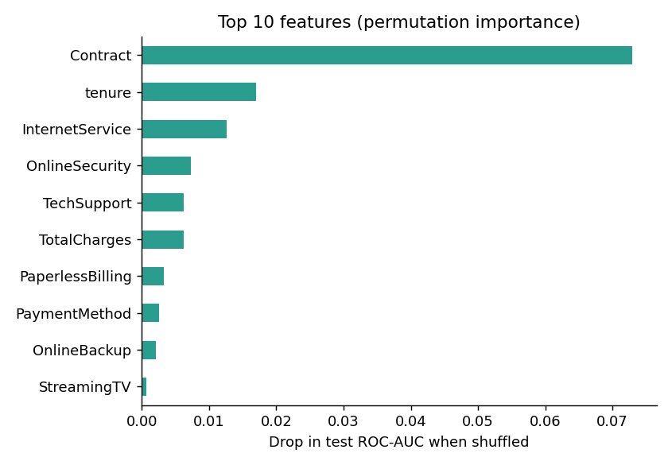

# Telco Customer Churn Predictor

Predict which telecom customers are likely to leave, and show the answer in an interactive
Streamlit app. The pipeline cleans the data, balances the classes with SMOTE, compares four
models, tunes a Random Forest, and serves it with a risk gauge and a what-if comparison.

**Stack:** Python, scikit-learn, imbalanced-learn, XGBoost, Plotly, Streamlit

## Results

Evaluated on a stratified 20% hold-out set (1,409 customers). Model comparison used 5-fold
cross-validation on the training set.

| Model | CV ROC-AUC | Test ROC-AUC |
|---|---|---|
| Logistic Regression | 0.845 | 0.840 |
| Decision Tree (depth 6) | 0.817 | 0.813 |
| Random Forest (default) | 0.820 | 0.818 |
| XGBoost (default) | 0.823 | 0.821 |
| **Random Forest (tuned)** | n/a | **0.838** |

Tuned Random Forest at threshold 0.5: churn recall 0.74, precision 0.54, F1 0.62.

A few honest takeaways:

- A plain Logistic Regression is about as good as the tuned forest. The signal in this
  dataset is mostly linear, so a simple model is a strong baseline.
- SMOTE is applied inside the cross-validation pipeline, so synthetic samples never leak into
  validation folds. Scores are lower than you get by oversampling before splitting, but they
  are more trustworthy.
- Threshold 0.5 favours recall of churners over precision. In a real retention campaign you
  would choose the threshold from the cost of an offer versus the value of a saved customer.

## What drives churn

- **Contract type** is by far the strongest signal. Month-to-month customers churn at about
  42.7%, one-year at 11.3%, and two-year at 2.8%.
- **Tenure**, **internet service type**, and whether the customer has **online security / tech
  support** come next.
- Gender and phone service add almost nothing.



## Project structure

```
telco-churn-predictor/
├── app/
│   └── streamlit_app.py        # Streamlit front end
├── data/raw/
│   └── telco_customer_churn.csv
├── models/
│   ├── churn_model.joblib      # trained pipeline (preprocess + SMOTE + RF)
│   └── metrics.json            # comparison, tuned metrics, importances
├── notebooks/
│   └── 01_churn_analysis.ipynb # EDA, model comparison, tuning, evaluation (with outputs)
├── reports/figures/            # EDA and model plots
├── src/churn/
│   ├── config.py               # paths and constants
│   ├── data.py                 # loading and cleaning
│   ├── pipeline.py             # preprocessing + SMOTE + model pipeline
│   ├── train.py                # compare, tune, evaluate, save
│   └── make_figures.py         # regenerate plots
├── requirements.txt
└── README.md
```

## Notebook

[`notebooks/01_churn_analysis.ipynb`](notebooks/01_churn_analysis.ipynb) walks through the whole
analysis with outputs saved: data-quality checks, EDA, the leak-free model comparison, tuning,
threshold trade-offs, permutation importance, and scoring a single customer. It imports the
cleaning and pipeline code from `src/churn/`.

## Quick start

```bash
git clone <your-repo-url>
cd telco-churn-predictor
python -m venv .venv && source .venv/bin/activate     # Windows: .venv\Scripts\activate
pip install -r requirements.txt

python -m src.churn.train          # trains and writes models/ (about a minute)
python -m src.churn.make_figures   # regenerates reports/figures/
streamlit run app/streamlit_app.py

pip install jupyterlab             # optional, to open the notebook
jupyter lab notebooks/01_churn_analysis.ipynb
```

The saved model is a pickle-based `joblib` file, so load it with the same scikit-learn version
you trained with. If you hit a version warning, just re-run `python -m src.churn.train`.

## The app

- **Sidebar form** for account, services, and household details. Add-on questions disappear
  when the customer has no internet service.
- **Risk card and gauge** with low / medium / high bands.
- **What-if chart** showing the same customer under each contract type.
- **Suggested actions** from simple business rules (contract upgrade, bundle security, and so on).
- **Model & data insights** tab with the model comparison and key plots.

## Data

[Telco Customer Churn](https://www.kaggle.com/datasets/blastchar/telco-customer-churn), an IBM
sample dataset with 7,043 customers and 20 features. 26.5% of customers churned. The 11 blank
`TotalCharges` values belong to customers with tenure 0 and are set to 0.

## Possible next steps

- Choose the decision threshold from a cost/benefit estimate rather than 0.5.
- Add probability calibration and per-customer SHAP explanations.
- Deploy to Streamlit Community Cloud.

## License

MIT. See [LICENSE](LICENSE).
